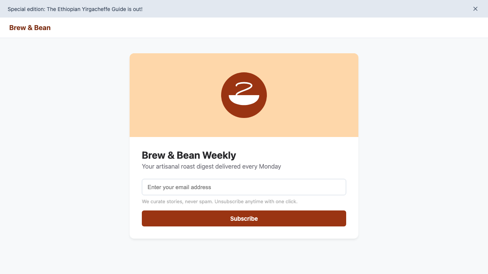

# AccessFix

> **AccessFix is an AI agent that browses a web page like a blind keyboard-only user, finds barriers, fixes the code, and proves the fix by re-running the agent.**

---

## 🚀 How It Works

Traditional accessibility tools generate static PDF reports that sit in developer backlogs for months. AccessFix introduces a closed-loop, task-driven repair pipeline:

1. **Scanner**: Executes an automated Axe WCAG audit and extracts the full accessibility snapshot (`ariaSnapshot`).
2. **Task Discovery**: Infers the single most important task a visitor comes to the page to accomplish (e.g., *"Subscribe to the newsletter with an email"*).
3. **Blind Agent**: Simulates a blind user navigating strictly via keyboard (`Tab`, `Shift+Tab`, `Enter`, `Space`, `Type:<text>`) and accessibility tree announcements (`{ role, name }`). If an element traps focus or is unreachable, the agent detects it and halts.
4. **Prioritizer**: Scores and ranks detected barriers deterministically by user impact (task-blocking barriers score +100, Axe critical +40, serious +30), tagging user types (blind, low-vision, keyboard-only).
5. **Fixer**: Resolves unambiguous selectors and synthesizes semantic HTML and CSS repairs (deterministic contrast stepping, `:focus-visible` styling, `<button>` transformations, labels, landmarks, alt text).
6. **Verifier**: Executes an iterative verification loop on an isolated working copy (up to 3 rounds). Measures pixel-level bounding-box layout shifts ($> 5\text{px}$) and re-runs the Blind Agent to mathematically verify that the task now succeeds.
7. **Report & Proof**: Generates a unified code `.diff`, live before/after sandboxed previews, Web Speech screen-reader vocalization, and routes ambiguous items to a human triage queue.

```
                  [ Web Page / URL ]
                          │
                          ▼
                     ┌─────────┐
                     │ Scanner │ (Axe WCAG audit + accessibility tree)
                     └────┬────┘
                          ▼
                  ┌───────────────┐
                  │ Task Discovery│ (Infers primary user goal)
                  └───────┬───────┘
                          ▼
                   ┌─────────────┐
                   │ Blind Agent │ (Keyboard-only traversal; detects trap)
                   └──────┬──────┘
                          ▼
                   ┌─────────────┐
                   │ Prioritizer │ (Scores barriers: task blockers +100)
                   └──────┬──────┘
                          ▼
                      ┌───────┐     Iterative Verification Loop (Max 3 rounds)
                  ┌──►│ Fixer │◄─────────────────────────────────────────────┐
                  │   └───┬───┘                                              │
                  │       ▼                                                  │
                  │  ┌──────────┐                                            │
                  │  │ Verifier │ (Bounding-box layout check + Re-run Agent)─┘
                  │  └────┬─────┘
                  │       │ (Passed)
                  ▼       ▼
              ┌────────────────┐
              │ Report & Proof │ (Unified .diff + Audio + Before/After Previews)
              └────────────────┘
```

---

## ⚡ Quick Start in 5 Lines

```bash
git clone https://github.com/sharmanitin6301-coder/fetchAi_hackathon.git && cd fetchAi_hackathon
npm install
npx playwright install chromium
cp .env.example .env # Add your GEMINI_API_KEY (or GROQ_API_KEY)
node server.js       # Open http://localhost:3000
```

---

## 🧪 Reproducing the Demo

AccessFix includes self-contained demo fixtures in `demo-sites/` designed to demonstrate real-world accessibility failures and automated repairs.

### 1. Broken Fixture (`demo-sites/broken.html`)
The default fixture models an artisanal coffee newsletter page with 6 planted accessibility barriers:
- **Missing alt text** on the hero coffee image
- **Nameless icon button** closing the promo banner
- **Unlabelled email input** (placeholder only)
- **Low-contrast helper text** (`#aaa` on `#ffffff`, ~2.3:1 ratio)
- **Fatal keyboard trap**: The "Subscribe" button is an unlabelled `<div>` with an `onclick` handler—completely unreachable and unactivatable via keyboard
- **Broken page structure**: Missing `lang="en"`, missing `<main>` and landmark regions, and an `<h4>` immediately following an `<h1>`

**Steps to run:**
1. Open `http://localhost:3000`.
2. Leave target path as `demo-sites/broken.html`.
3. Click **"Run AccessFix"**.
4. Observe the initial Blind Agent run get trapped at step 12.
5. Watch AccessFix synthesize 11 semantic operations, rebuild the working copy, and re-run the Blind Agent—completing the task in **5 steps with 0 remaining Axe violations**.
6. Inspect the generated unified diff, before/after preview frames, and simulated screen-reader audio phrases.

### 2. Verified Fixed Fixture (`demo-sites/fixed.html`)
To confirm that compliant pages pass cleanly:
1. In the target input, select or type `demo-sites/fixed.html`.
2. AccessFix supports running this fixture in two modes:
   - **With "Use cached demo" ON:** Replays a verified recorded run directly from `cache/fixed/run.json` with zero latency or external API calls.
   - **With "Use cached demo" OFF:** Executes the full live pipeline (Chromium scan, goal identification, live Blind Agent keyboard navigation, layout checks, and verification).
3. **What to expect:**
   - **0 Axe WCAG violations** detected before and after.
   - The Blind Agent succeeds immediately on the page without getting stuck.
   - **0 repairs applied**: The Diff view reports *"No code changes needed, the page passed all accessibility checks."*

### 3. Running Offline / Cached Demo (`DEMO_CACHE=true`)
For hackathon presentations or offline environments with unreliable Wi-Fi:
- **Option A (UI Checkbox):** Keep the **"Use cached demo"** checkbox checked in the dashboard.
- **Option B (Environment Variable):** Set `DEMO_CACHE=true` in your `.env` file.

In cached mode, the server makes **zero network or LLM calls** and does not launch Chromium. It replays the verified execution stream from `cache/<site>/run.json` over Server-Sent Events with realistic delays (0.5s–2.0s per stage), making it 100% immune to network outages.

### 4. How to Record Runs
You can generate or refresh cached demo runs using the CLI recorder:
```bash
# Record both broken.html and fixed.html (full suite)
npm run record

# Record fixed.html only (saves to cache/fixed/run.json)
npm run record -- fixed

# Record broken.html only (saves to cache/broken/run.json)
npm run record -- broken
```

### 5. Pitch Deck
A presentation deck matching the dashboard palette is included in `pitch/slides.html`:
- Open `pitch/slides.html` directly in your browser or visit `http://localhost:3000/pitch/slides.html`.
- Navigate using keyboard arrow keys (`←` / `→`) or `Space`.
- Press `T` on Slide 4 to start/pause the 3:00 live demo countdown timer.
- Accompanied by the 3-minute pitch script in `pitch/script.md`.

### 6. Health & Readiness Endpoint
Visit `http://localhost:3000/health` in your browser or make a GET request:
```bash
curl http://localhost:3000/health
```
Returns a clear status indicator (`Ready for demo: YES/NO`), checking the validity of cached demo files (`cache/broken/run.json`), configured API keys, active provider order, provider quota/exhaustion states, and Agent API token status.

### 7. Agentverse Hosted Agent API
AccessFix exposes a secure REST API designed specifically for Fetch.ai Agentverse Hosted Agents and conversational AI interfaces:
- **`POST /api/agent/runs`**: Triggers an accessibility audit. Accepts `{ "url": "demo-sites/broken.html", "useCache": true }`. Returns `{ "runId": "...", "status": "pending", "pollUrl": "..." }`.
- **`GET /api/agent/runs/:runId`**: Polls execution status and returns genuine accessibility metrics (`axeBefore`, `axeAfter`), Blind Agent before/after traversal outcomes, synthesized fixes applied, layout shifts, human triage queue, and unified diff.
- **Authentication**: Requires a Bearer token matching `ACCESSFIX_AGENT_TOKEN` in the `Authorization` header.
- **Security & SSRF Safeguards**: Blocks loopback (`127.0.0.1`, `localhost`), private subnets (`10.*`, `192.168.*`, `172.16-31.*`), and cloud metadata (`169.254.169.254`, `metadata.google.internal`). Local filesystem inputs are strictly restricted to predefined demo fixtures (`demo-sites/broken.html`, `demo-sites/fixed.html`).

An official Python adapter implementing Fetch.ai's **Agent Chat Protocol (ACP)** is available in [`agentverse/`](agentverse/README.md).

### 8. Environment Variables
Configure the pipeline in your `.env` file:
- `ACCESSFIX_AGENT_TOKEN`: Secret Bearer token required for Agentverse API calls (`POST /api/agent/runs`, `GET /api/agent/runs/:runId`).
- `HOST`: Server bind address (default: `0.0.0.0`, compatible with cloud container runtimes).
- `PORT`: HTTP server port (default: `3000`).
- `GEMINI_API_KEY`: API key for Google Gemini (e.g. from Google AI Studio).
- `GEMINI_MODEL`: Model identifier (default: `gemini-2.5-flash`).
- `GROQ_API_KEY`: API key for Groq Cloud.
- `GROQ_MODEL`: Model identifier (default: `llama-3.3-70b-versatile`).
- `LLM_PROVIDER_ORDER`: Comma-separated fallback chain, e.g. `groq,gemini,openrouter`. Providers returning 429 or 503 errors are automatically marked exhausted for 10 minutes and bypassed without latency.
- `DEMO_CACHE`: When set to `true`, forces cached replay mode for all runs, skipping live browser and LLM calls.

### 9. Cloud Deployment
AccessFix is production-ready for cloud container hosting (Render, Railway, Fly.io, Google Cloud Run, AWS App Runner):
- The server binds to `0.0.0.0` and respects `process.env.PORT` automatically.
- Start command: `npm start` (executes `node server.js`).
- If deploying in an environment without Chromium GUI, ensure Playwright dependencies are installed (`npx playwright install --with-deps chromium`) or run in demo cache mode (`DEMO_CACHE=true`).

---

## 📸 Screenshots

| Original Broken Fixture (`cache/broken/before.png`) |
| :---: |
|  |
| *Visual appearance looks polished, but the Subscribe control is a keyboard-inaccessible `<div>` with unlabelled inputs and poor contrast.* |

---

## 🛠️ Tech Stack

- **Runtime & Architecture:** Node.js (ES Modules)
- **Browser Automation & Auditing:** [Playwright](https://playwright.dev/) & [@axe-core/playwright](https://github.com/dequelabs/axe-core-npm/tree/develop/packages/playwright)
- **Primary AI Intelligence:** Google Gemini (`@google/genai`)
- **Resilient AI Fallback:** Groq (`groq-sdk`) / OpenRouter for automatic failover during 503s or rate limits
- **Server & SSE Streaming:** Express 5
- **DOM Parsing & Code Patching:** [Cheerio](https://cheerio.js.org/) & [diff](https://www.npmjs.com/package/diff)
- **Accessible Speech & Transcripts:** Web Speech API & [JSDOM](https://github.com/jsdom/jsdom)

---

## 🛡️ Honest Notes & Limitations

- **Agent Retries & Hallucination Mitigation:** The Blind Agent is driven by an LLM and can occasionally wander or lose context during keyboard navigation. If a run ends in `FAIL` due to a focus loop or reaching the step limit, AccessFix automatically reloads the page, clears the action history, and attempts one fresh retry. Both attempts are preserved in the saved transcript (`attempt: 1` and `attempt: 2`) with the final failure reason announced clearly on the Status line.
- **Provider Quotas & Automatic Fallback:** Free-tier Gemini quota is small and prone to rate limits during hackathon traffic. AccessFix defaults to Groq first (`LLM_PROVIDER_ORDER=groq,gemini,openrouter`), remembers exhausted providers for 10 minutes, and automatically falls back to replaying the saved cache if every provider fails so presentations never stall.
- **Automation Cannot Catch Everything:** WCAG automated tools typically detect only 30%–40% of accessibility issues. AccessFix focuses on the most critical, task-blocking barriers (unlabelled buttons, missing form labels, missing alt text, keyboard navigation traps, heading hierarchies, and contrast). Subjective design choices and nuanced usability items are routed to the **"Needs a Human"** triage queue.
- **Human Developer Review Required:** AccessFix outputs unified `.diff` patches applied to an isolated working copy. Patches should always be reviewed and approved by engineering and design teams before deploying to production.
- **Privacy & LLM Usage:** Free-tier and commercial LLM API endpoints may log or process prompts. Do not audit private, authenticated, or sensitive internal applications with public or free-tier API keys.
- **Layout Shift Safeguards:** While our Playwright layout engine flags any element shift greater than 5 pixels, visual regression testing in complex responsive viewports should still be validated by human designers.
